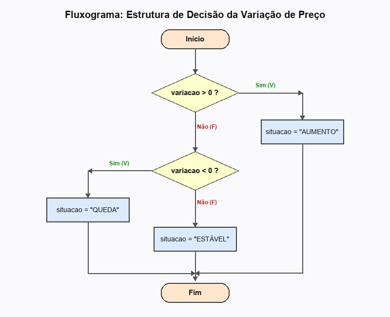
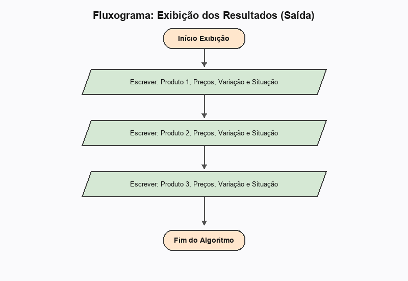

# Monitoramento de Preços da Cesta Básica (Pseudocódigo + C11)

Ferramenta de análise comparativa de variação mensal de preços de produtos da cesta básica. Reúne a modelagem algorítmica original em **pseudocódigo (Portugol)** e **fluxogramas** com uma implementação modular em **C11**, cobertura de testes unitários, validação segura de entrada e CI automatizado em `gcc` e `clang` com AddressSanitizer/UBSan.

[](https://github.com/cgn2222/ads-algoritmos-cesta-basica/actions/workflows/ci.yml)


---

## Problema e fórmula

Dado um conjunto de 3 itens da cesta básica (nome, preço no mês anterior e preço no mês atual), o algoritmo calcula a variação percentual:

$$\text{variação (\%)} = \left(\frac{\text{preço}_{\text{atual}} - \text{preço}_{\text{anterior}}}{\text{preço}_{\text{anterior}}}\right) \times 100$$

Cada produto é classificado em:
- **`AUMENTO`** quando $\text{variação} > \varepsilon$
- **`QUEDA`** quando $\text{variação} < -\varepsilon$
- **`ESTAVEL`** quando $|\text{variação}| \le \varepsilon$ ($\varepsilon = 10^{-9}$)

---

## Fluxogramas e pseudocódigo

- Pseudocódigo formal completo (Portugol): [`docs/pseudocodigo.txt`](docs/pseudocodigo.txt)

### Estrutura de decisão


### Exibição consolidada dos resultados


---

## Como compilar e executar

Requisito: `gcc` ou `clang` com suporte a **C11** e `make`.

```bash
# Compilar o binário principal (-std=c11 -Wall -Wextra -Wpedantic -Werror)
make

# Executar demonstração com 3 itens típicos da cesta básica
make demo

# Executar em modo interativo (aceita ponto ou vírgula como separador decimal)
make run

# Rodar suíte de testes unitários + testes de integração da CLI
make test

# Rodar testes com AddressSanitizer e UndefinedBehaviorSanitizer
make sanitize
```

### Exemplo de saída (`make demo`)

```text
================================================================================
              MONITORAMENTO DE PRECOS DA CESTA BASICA (RELATORIO)
================================================================================
PRODUTO                  |   ANTERIOR |      ATUAL |   VARIACAO | SITUACAO
--------------------------------------------------------------------------------
Arroz Tipo 1 (5kg)       | R$   25.00 | R$   28.50 |    +14.00% | AUMENTO
Feijao Carioca (1kg)     | R$    8.50 | R$    7.65 |    -10.00% | QUEDA
Oleo de Soja (900ml)     | R$    6.40 | R$    6.40 |     +0.00% | ESTAVEL
================================================================================
Total cesta (mes anterior): R$ 39.90
Total cesta (mes atual)   : R$ 42.55
Variacao global da cesta  : +6.64%
Variacao media simples    : +1.33%
Resumo classificacoes     : 1 AUMENTO | 1 QUEDA | 1 ESTAVEL
================================================================================
```

---

## Decisões de engenharia e trade-offs

| Decisão | Justificativa | Trade-off / Evolução |
| --- | --- | --- |
| **Separação domínio vs. I/O (`cesta_basica.c` / `main.c`)** | Permite testar a lógica de cálculo e classificação de forma determinística sem depender de `stdin`/`stdout`. | Mantém um módulo coeso sem abstrações desnecessárias. |
| **Guarda de domínio (`preco_anterior > 0` e `isfinite`)** | Impede divisão por zero, `NaN`, `Inf` e preços negativos antes do cálculo. | Retorna enum de erro explícito (`CestaStatus`) em vez de abortar o processo. |
| **Tolerância `CESTA_EPSILON` (`1e-9`)** | Evita classificações incorretas por ruído IEEE-754 (ex.: `0.1 + 0.2` vs `0.3`) e elimina `-0.00%` na saída. | Em sistemas contábeis/fiscais, substituir `double` por ponto fixo inteiro em centavos (`int64_t`). |
| **Leitura com `fgets` + `strtod` em vez de `scanf`** | Impede loops infinitos quando o usuário digita texto inválido e suporta vírgula decimal (`6,40`). | Código de parsing ligeiramente mais verboso que `scanf`, porém seguro em produção. |

---

## Estrutura do repositório

```text
ads-algoritmos-cesta-basica/
├── .github/workflows/ci.yml      # CI com gcc, clang, ASan e UBSan
├── Makefile                      # Build estrito C11, testes e sanitizers
├── diagrams/
│   ├── fluxograma-decisao.png
│   └── fluxograma-exibicao.png
├── docs/
│   └── pseudocodigo.txt          # Especificação original em Portugol
├── src/
│   ├── cesta_basica.h            # Contratos, structs e códigos de status
│   ├── cesta_basica.c            # Núcleo de cálculo e classificação
│   └── main.c                    # CLI interativa + modo --demo
└── tests/
    ├── test_cesta_basica.c       # Testes unitários (casos normais e borda)
    └── test_cli.sh               # Testes de integração da CLI
```

---

## Créditos

Desenvolvido por **Carlos Gabriel Novo** no curso superior de tecnologia em **Análise e Desenvolvimento de Sistemas** (Cruzeiro do Sul Virtual, 2026) — disciplina de *Algoritmos e Pensamento Computacional* (Experiência Prática I).

Distribuído sob licença **MIT** ([`LICENSE`](LICENSE)).
